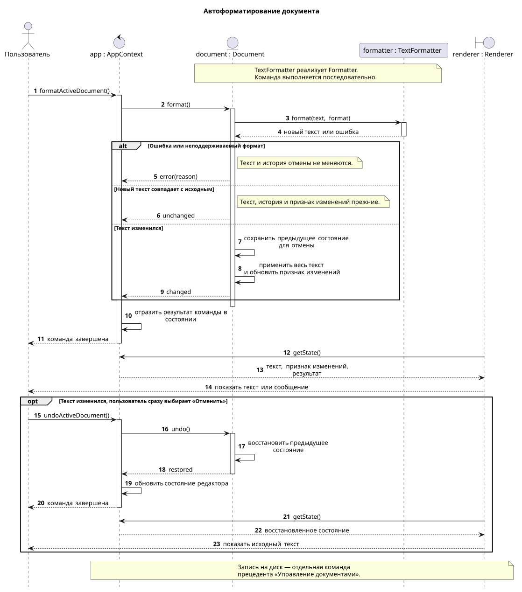

# Прецедент «Автоформатирование документа»

**Рамки:** приложение «Текстовый редактор».

**Уровень:** задача пользователя.

**Основной исполнитель:** пользователь.

**Ответственный за сценарий:** mcdzaq.

### Заинтересованные лица и их требования

Пользователь хочет привести оформление текста к единым правилам: убрать лишние пробелы и исправить их расположение около знаков препинания. Смысл текста и структура документа должны сохраниться.

### Предусловия

Редактор запущен, активен открытый или созданный текстовый документ. Сохранение нового документа в файл не требуется.

### Результаты (постусловия)

- Исправленный текст находится в контексте документа и виден пользователю.
- Признак несохранённых изменений соответствует сравнению с последней сохранённой версией.
- Форматирование можно отменить одной командой; файл на диске пока не изменён.

### Основной успешный сценарий

1. Пользователь выбирает «Форматировать документ».
2. Система получает текущий текст активного документа и сведения о его формате.
3. Форматировщик применяет правила оформления и возвращает новый текст.
4. Система сохраняет предыдущее состояние для отмены и заменяет текст документа целиком.
5. Система обновляет состояние документа в контексте редактора, включая признак несохранённых изменений.
6. Пользователь видит отформатированный текст и продолжает работу.

### Расширения (альтернативные потоки)

| Шаг | Ситуация | Действия системы |
| --- | --- | --- |
| 3а | Изменения не нужны, в том числе документ пуст | Сообщить «Изменений нет». Сохранить текст, историю отмены и признак несохранённых изменений. |
| 3б | Ошибка форматировщика или неподдерживаемый формат | Показать причину отказа. Сохранить исходное состояние документа без частично применённых исправлений. |
| 3в | Отдельный участок нельзя безопасно преобразовать | Оставить этот участок без изменений и обработать остальные. Продолжить с шага 4, если текст изменился; иначе перейти к 3а. |
| 6а | Пользователь сразу отменяет форматирование | Восстановить предыдущее состояние документа и обновить отображение. Форматировщик повторно не вызывается. |

Пользователь сохраняет результат отдельной командой из прецедента [«Управление документами»](../document_operations/document_operations.md). Ошибка записи обрабатывается там и не удаляет текст из редактора.

### Специальные требования

- Команда обрабатывает весь активный документ по запросу пользователя. Автоматический запуск при наборе текста в этот сценарий не входит.
- Правила относятся к типографике обычного текста, например к повторяющимся пробелам и пробелам около знаков препинания. Исправление орфографии относится к [линтингу](../document_linting/document_linting.md).
- Форматировщик должен учитывать формат документа: значимые отступы, код, разметку, адреса и числа нельзя обрабатывать слепой заменой пробелов и пунктуации. Неоднозначные участки сохраняются; если безопасная обработка формата невозможна, применяется 3б.
- Результат применяется целиком только после успешной обработки. При ошибке текст и история отмены не меняются.
- Повторное форматирование уже обработанного текста с теми же правилами не должно давать новых изменений.
- Форматировщик не записывает файл и не управляет интерфейсом или историей отмены.

### Участники реализации и данные

Используются классы из общей [диаграммы классов](../../class_diagram.md). Ниже предложены их обязанности и операции для этого сценария; работающей реализации в репозитории пока нет.

| Класс | Обязанность |
| --- | --- |
| `AppContext` | Хранить активный `Document`, принять `formatActiveDocument()` и отразить результат команды в состоянии редактора. |
| `Document` | Вызвать `format()`, применить новый текст как одну отменяемую операцию и обновить признак несохранённых изменений. |
| `Formatter` | Задать контракт `format(text, format)`: вернуть новый текст или ошибку, не меняя сам документ. |
| `TextFormatter` | Реализовать `Formatter` с правилами типографического оформления. |
| `Renderer` | Прочитать состояние `AppContext` и показать текст либо сообщение о результате. |

Вход форматировщика — текст и формат документа; выход — новый текст либо ошибка. Историю предыдущих состояний хранит `Document`. Для нового файла признак несохранённых изменений определяется относительно исходного пустого документа.

В диаграмме показано последовательное выполнение команды: изменения того же документа не вклиниваются между чтением текста и применением результата. Если форматирование будет вынесено в фон, перед применением потребуется проверять идентификатор и версию документа.

### Диаграмма последовательностей

[Редактируемый исходник PlantUML](document_formatting_sequence.puml). `formatter: TextFormatter` используется через интерфейс `Formatter`; имена операций — предложение для будущей реализации.

SVG строится из этого исходника командой `java -jar plantuml.jar -charset UTF-8 -tsvg -nometadata document_formatting_sequence.puml` из текущего каталога; для локального запуска нужен Java Runtime и PlantUML.

### Частота использования

По запросу пользователя во время редактирования.

### Открытые вопросы

- Какой точный набор правил и естественных языков нужен в первой версии?
- Как выделять обычный текст и защищённые участки в поддерживаемых форматах, включая Typst?
- Нужны ли настройка правил и форматирование только выделенного фрагмента?
- Достаточно ли последовательного выполнения команды или потребуется фоновая обработка больших документов?
